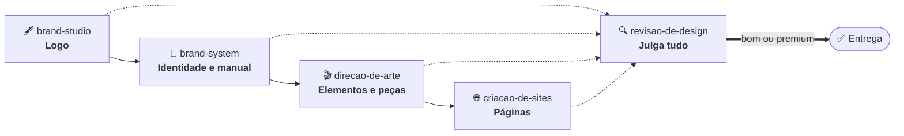
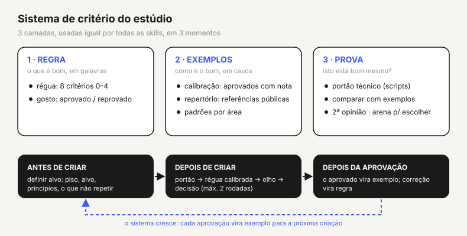

<div align="center">

# 🎨 Estúdio de Design

### Um estúdio de identidade visual inteiro, dentro do Claude Code

Cinco "profissionais" que criam **logo, marca, peças para Instagram e sites** e que se revisam entre si
antes de mostrar qualquer coisa. Tudo em português do Brasil.


</div>

---

## 💡 A ideia em 30 segundos

Imagine contratar um **estúdio de design**. Ele tem uma equipe: quem desenha o logo, quem monta a identidade
inteira, quem faz os posts, quem constrói o site e, o mais importante, **alguém que olha tudo com olho crítico
antes de entregar**.

Este repositório é essa equipe, em forma de **skills** do Claude Code. Você conversa em português, diz o que
precisa, e o Claude chama o profissional certo:

> *"Crie a identidade visual da minha academia."*
> *"Faça 6 posts para o lançamento, nenhum igual ao outro."*
> *"Monte uma página de captura para o evento."*

E o que sai **já passou por conferência de código e por uma nota de qualidade**. Nada de entregar a primeira
coisa que ficou pronta.

---

## 👥 A equipe

| | Skill | Pense nela como… | Em uma frase |
|---|---|---|---|
| 🖋️ | [`brand-studio`](brand-studio) | o **ilustrador / mesa de produção** | Faz o logo e todas as ferramentas de produção |
| 🧭 | [`brand-system`](brand-system) | o **estrategista de marca** | Transforma um logo em uma identidade completa, com manual |
| 🎬 | [`direcao-de-arte`](direcao-de-arte) | a **diretora de arte** | Compõe peças e séries que não parecem template |
| 🌐 | [`criacao-de-sites`](criacao-de-sites) | o **desenvolvedor de landing pages** | Constrói páginas de conversão prontas para publicar |
| 🔍 | [`revisao-de-design`](revisao-de-design) | a **crítica rígida** | Julga tudo, dá nota e limita o retrabalho |

---

### 🖋️ `brand-studio` · logo e motores de produção

**Para que serve:** criar logos e produzir o material gráfico base. É a "caixa de ferramentas" que as outras
skills usam por baixo.

**O que faz**
- Cria **conceitos de logo** e confere se algum se parece demais com marcas que já existem (teste de originalidade).
- Monta **lockups** (logo + texto), selos circulares, padrões, key visuals e peças avulsas.
- Gera **3D**, recorta fotos, amplia imagem sem perder qualidade e transforma imagem em vetor.
- Usa **IA de imagem (Gemini / Nano Banana 2.1)** para cenários e composições difíceis. Nunca para pessoas.
- Anima logo em vídeo e dá acabamento (grão, meio-tom, brilho).
- Confere a qualidade do logo pronto: em que fundos funciona, se ficou cortado, se aguenta tamanho pequeno.

**Peça assim:** *"Faça 4 conceitos de logo para uma academia de bairro."* · *"Recorte essa foto e deixe em P&B."*

**Entrega:** logos em SVG e PNG em várias cores, lockups, selos, padrões e prévias.

---

### 🧭 `brand-system` · da marca ao manual

**Para que serve:** quando o logo já existe e você precisa de uma **identidade inteira**: cores, fontes,
elementos próprios, regras e manual.

**O que faz, em ordem**
1. **Pesquisa** a categoria e entende o público.
2. Define a **plataforma da marca** (quem é, o que promete), antes de falar em cor.
3. Mostra um **primeiro impacto** visual rápido, para você reagir cedo.
4. **Cores** com contraste conferido (acessibilidade) e **tipografia** com hierarquia.
5. Cria **elementos gráficos exclusivos**, derivados do próprio logo.
6. Define **modelos de peça** (o "molde" de cada tipo de post), com variações limitadas.
7. Gera **mockups**, **design tokens** (CSS, Tailwind, Figma) e o **manual da marca** em PDF e web.

**Peça assim:** *"Monte a identidade completa e o manual dessa marca."* · *"Quais cores combinam e passam no contraste?"*

**Entrega:** `brand.json` (a fonte da verdade da marca), paleta, tipografia, elementos, modelos de peça,
tokens e o manual.

---

### 🎬 `direcao-de-arte` · peças e séries únicas

**Para que serve:** criar **posts, stories, anúncios, banners e capas** que parecem feitos por uma pessoa com
estilo, e não por um gerador.

**O que faz**
- **Kit de elementos:** biblioteca com **700+ elementos** em 15 famílias, gerados com as cores e o traço da marca.
- **Tipografia com voz:** escolhe fontes com prova (legibilidade no celular, acentos do português, licença).
- **Composição por camadas:** fundo, foto, elementos, texto. Cada camada é verificada.
- **Séries sem repetição:** 22 arquétipos de dobra e 35 movimentos, para nunca fazer "o mesmo post com outra cor".
- **Zonas seguras:** simula a interface do Instagram por cima da peça e garante que nada importante fique escondido.
- **Verificação por código:** mede margens, alinhamento, colisão, contraste e se o rosto foi coberto.

**Peça assim:** *"Faça uma série de 6 posts de lançamento, cada um com uma ideia diferente."*

**Entrega:** peças em 1:1, 4:5 e 9:16, prontas para postar, com a prova de camadas.

---

### 🌐 `criacao-de-sites` · páginas que convertem

**Para que serve:** construir **páginas de captura, vendas, evento ou hotsite** para quem já tem identidade e logo.

**O que faz**
- Parte de um **template profissional** (Next.js estático + Tailwind 4 + GSAP) e aplica cores, fontes, logo e textos da marca.
- Segue um **padrão fixo de página**: primeira dobra = tela inteira, espaçamentos em 12 · 24 · 40, ordem
  imagem → título → botão, movimento sempre ligado.
- **Verifica sozinho** (build, layout em vários tamanhos de tela, peso, diferença de copy) até zerar os erros.
- Entrega **3 pacotes**: raiz do domínio, subpasta e código-fonte. Funciona na **Vercel** e na **Hostinger**.
- Gera **prévias** atuais de cada página, nos dois temas (escuro e claro).

**Peça assim:** *"Monte a página de captura do meu evento, com contagem regressiva e pop-up de cadastro."*

**Entrega:** 3 zips prontos para publicar + prévias + relatório de verificação.

---

### 🔍 `revisao-de-design` · o senso crítico do estúdio

**Para que serve:** garantir que **nada ruim chega até você**. Todas as outras skills passam por ela.

**O que faz**
- **Define o alvo antes de criar:** mostra exemplos calibrados do mesmo tipo e o que não repetir.
- **Portão técnico:** os scripts precisam dar zero erros.
- **Régua de 8 critérios** (0 a 4) que resulta em um destes níveis:

  | Nível | Significa |
  |---|---|
  | 🔴 **Ruim** | tem defeito visível: quebrado, desalinhado, ilegível |
  | 🟡 **Normal** | correto e limpo, mas genérico. **Não sai da mesa.** |
  | 🟢 **Bom** | tem ideia própria, hierarquia forte, elementos com função |
  | 💎 **Premium** | assinatura inconfundível, acabamento medido, nada a tirar |

- **Máximo 2 rodadas de correção.** Se ainda não está bom, devolve a você dizendo o que falta, sem ficar em laço infinito.
- **Arena:** quando é preciso *escolher* entre opções, um torneio às cegas decide.
- **Modo econômico:** regras para gastar menos tokens sem perder qualidade.

**Peça assim:** *"Avalie esse logo e diga se é bom ou normal."* · *"Compare essas 3 peças."*

---

## 🔗 Como elas trabalham juntas



Em todas, o caminho é o mesmo: **definir o alvo → criar → revisar → (no máximo 2 correções) → entregar → aprender**.

<div align="center">

</div>

---

## ✨ O que torna este estúdio diferente

| Princípio | Na prática |
|---|---|
| **Elementos antes de peças** | O kit de elementos nasce antes de qualquer post ou página, para tudo ter a mesma "língua". |
| **Pesquisa nova a cada criação** | Fontes, elementos, composições e referências são pesquisados do zero, para o trabalho terminar diferente do anterior. |
| **Padrão fixo, criatividade livre** | A estrutura (espaços, dobra, ordem) é padronizada. A criatividade mora no que sobra dentro dela. |
| **Referência é régua, não molde** | Aprende o princípio de um bom exemplo e faz a versão própria. Nunca copia. |
| **Foto real para pessoas** | IA só gera cenário e complemento. Pessoas são fotos reais recortadas. |
| **Texto em fonte, nunca em imagem de IA** | Evita letra torta e palavra errada. |
| **Medir, não achar** | Margem, alinhamento e contraste são medidos por código antes de qualquer olho. |
| **Aprende com cada aprovação** | O que foi aprovado vira exemplo; cada correção vira regra. |

---

## 🚀 Como instalar

### Como plugin (recomendado)

No Claude Code:

```text
/plugin marketplace add JuliusBrussee/caveman
/plugin marketplace add personaltraineracademy-cwb/estudio-design-skills
/plugin install estudio-design@estudio-design
```

O plugin usa o [caveman](https://github.com/JuliusBrussee/caveman) para respostas curtas (menos tokens gastos).

### Como skills soltas

Copie as pastas `brand-studio`, `brand-system`, `direcao-de-arte`, `criacao-de-sites` e `revisao-de-design`
para `~/.claude/skills/`, **lado a lado** (elas se referenciam entre si).

### No primeiro uso

A skill roda um verificador e diz o que falta, em três níveis:

| Nível | O quê | Custo |
|---|---|---|
| **Obrigatório** | Python 3.11+, pacotes do `requirements.txt`, Google Chrome | grátis |
| **Recomendado** | Node.js 22+, FFmpeg, modelos locais, skill `logo-design` | grátis |
| **Opcional** | API do Gemini (imagem por IA), conector Adobe, Vercel/Hostinger | Gemini é pago (cerca de US$ 0,03–0,11 por imagem) |

```bash
python brand-studio/scripts/instalar.py   # instala o que é Python e os modelos pequenos
python brand-studio/scripts/doctor.py     # confere de novo
```

Sem Gemini, tudo funciona com motores gratuitos. A IA é um extra.

---

## 💬 Pedidos prontos para colar

```text
Crie a identidade visual completa para <marca>: pesquisa, plataforma, cores, tipografia,
elementos e manual. Mostre primeiro 3 caminhos diferentes com nota.
```

```text
Faça uma série de 6 posts 4:5 para <campanha>. Cada post com uma composição diferente.
Passe pelo portão técnico e me mostre só os que forem bom ou premium.
```

```text
Monte a página de captura de <evento> em Next.js, com copy final, pop-up de cadastro e
contagem regressiva. Gere os 3 pacotes e as prévias nos dois temas.
```

```text
Avalie estes 3 logos na régua de qualidade e diga qual é premium, qual é só normal e por quê.
```

---

## 🗂️ O que tem em cada pasta

```
.
├── brand-studio/        logo, lockups, selos, 3D, recorte, IA de imagem, animação
├── brand-system/        identidade, paleta, tipografia, modelos de peça, tokens, manual
├── direcao-de-arte/     composição, elementos (700+), tipografia, camadas, zonas seguras
├── criacao-de-sites/    template Next.js, receitas de dobra, verificadores, prévias
├── revisao-de-design/   régua, gosto, calibração, repertório, arena, economia
├── _ferramentas/        validador do pacote e gerador de diagramas
├── .claude-plugin/      manifesto do plugin e do marketplace
└── README-TECNICO.md    detalhes de arquitetura, requisitos e publicação
```

Cada skill tem a mesma organização por dentro: `SKILL.md` (fluxo curto) · `references/` (conhecimento detalhado,
um assunto por arquivo) · `scripts/` (ferramentas, todas com `--help`) · `assets/` (templates, diagramas, fontes livres).

---

## 🔒 Seus arquivos ficam com você

As skills **não guardam nada seu**. Biblioteca de clientes, chaves de API e projetos ficam numa pasta de trabalho
que você define (`ESTUDIO_DIR`). Chaves ficam num `.env` local, que nunca entra em pacote nenhum.
O pacote passa por um validador que procura caminhos pessoais, e-mails, chaves e nomes de clientes antes de ser publicado.

---

## 🙏 Créditos e licenças

- Skills sob licença **MIT** ([`LICENSE`](LICENSE)).
- Fontes em `assets/` sob **OFL**, com a licença ao lado de cada uma.
- Bibliotecas JavaScript em `direcao-de-arte/assets/web/vendor/` sob a licença de cada projeto (GSAP: licença gratuita *standard no-charge*).
- Modo econômico: plugin [caveman](https://github.com/JuliusBrussee/caveman).
- Craft e auditoria de logo (opcional, instalada à parte): [logo-design](https://github.com/kaankiziltug/logo-design-skill), MIT.

<div align="center">
<sub>Feito em português do Brasil · testado em projetos reais · sempre com no máximo 2 rodadas de correção 😉</sub>
</div>
